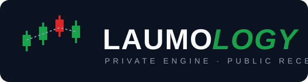

# LAUMOLOGY

**Private engine. Public receipts.**

Honest, auditable stock signals for the Indonesian Stock Exchange (IDX) —
with a live track record that shows the losses, not just the wins.

**[Live app](https://laumology.onrender.com)** ·
**[Track record](https://laumology.onrender.com/track-record)** ·
[What is this?](#-what-is-this) · [Apa ini?](#-apa-ini)

---

## 📈 What is this?

LAUMOLOGY is a live signal engine for IDX (Indonesian) stocks. It scans the
market during trading hours, scores every candidate 0–100 with objective,
causal indicators — no look-ahead, no curve fitting — and publishes every
verdict on a public track record page: the wins **and** the losses.

Most AI predictors show you their highlights. LAUMOLOGY shows you its
accounting.

### Where is the code?

The engine is private — it's a live product, not a template. The receipts
are public. Don't read the code; read the
[track record](https://laumology.onrender.com/track-record).

## 🤖 How is this different?

You may have seen viral "Predict Anything" projects like
[MiroFish](https://github.com/666ghj/MiroFish) — an LLM-agent predictor with
84k stars. This is the opposite bet:

| | MiroFish-style LLM predictors | LAUMOLOGY |
|---|---|---|
| Promise | "Predict Anything" | Predict IDX stocks — and admit when you're wrong |
| Engine | LLM agents + API tokens | Deterministic rules, causal indicators |
| Hallucination risk | Inherent | Impossible — every score is reproducible |
| ML policy | — | Model stays benched (alpha = 0) until it beats an out-of-sample AUC gate |
| Running cost | LLM API bills | $0 — Flask + SQLite on a free tier |
| Track record | — | Public: win rate, verdicts, losses, and where each call went wrong |
| Focus | General purpose | IDX specialist: IHSG regime filter, WIB market hours |

Both approaches are fun. Only one of them can't hallucinate.

## ✨ Features

- **Scoring 0–100** — objective, a-priori indicators; the score is never
  tuned to flatter backtests.
- **IHSG regime gate** — BUY signals are muted when the whole market is in
  a downtrend.
- **Direction-aware verdicts** — every signal is graded at H+5/H+10:
  *truly right*, *merely following the market*, or *wrong* — and **where**
  it went wrong (stop-loss hit first, lost to IHSG, told you to sell and it
  rose).
- **Attribution** — win rate per score bucket: which signal groups actually
  earn money, with small-sample groups honestly hidden.
- **Paper-trading funnel** — signals prove themselves on paper before
  anything else.
- **Honest ML** — a model is trained on weekends, but it stays benched
  (alpha = 0) until its out-of-sample AUC beats the promotion gate. No
  black-box vibes.
- **Deduplicated by design** — one observation per ticker per day, so the
  track record counts events, not noise.

## 📋 Disclaimer

Not financial advice. Signals are an opinion from deterministic rules;
verify before you trade. Past performance — honestly published on the
[track record](https://laumology.onrender.com/track-record) — does not
guarantee future results.

---

## 🇮🇩 Apa ini?

LAUMOLOGY adalah mesin sinyal live untuk saham IDX. Saat jam bursa, sistem
memindai pasar dan memberi skor 0–100 pakai indikator objektif dan kausal
(tanpa look-ahead, tanpa curve fitting) — lalu semua vonisnya dipublikasikan
di halaman track record: yang **benar** maupun yang **salah**.

Prediktor AI kebanyakan memperlihatkan highlight-nya saja. LAUMOLOGY
memperlihatkan pembukuan-nya.

### Kenapa kodenya tidak ada di sini?

Enginenya private — ini produk live, bukan template. Bukti hasilnya publik.
Jangan baca kodenya; [baca track record-nya](https://laumology.onrender.com/track-record).

### Bedanya dengan MiroFish?

[MiroFish](https://github.com/666ghj/MiroFish) (84 ribu stars) bertaruh pada
LLM yang bisa "Predict Anything". LAUMOLOGY bertaruh sebaliknya: aturan
deterministik yang **tidak bisa halusinasi** — plus kejujuran mempublikasikan
sinyal yang salah. Keduanya seru; hanya salah satunya yang tidak mungkin
berhalusinasi.

### Fitur

- **Skor 0–100** — indikator objektif a priori; skor tidak pernah di-tuning
  demi backtest yang cantik.
- **Gerbang regime IHSG** — sinyal BUY ditahan saat pasar secara keseluruhan
  downtrend.
- **Vonis sadar-arah** — tiap sinyal dinilai H+5/H+10: benar nyata / cuma
  ikut pasar / salah — plus **letak kesalahannya** (SL kena duluan, kalah dari
  IHSG, disuruh jual ternyata naik).
- **Atribusi** — win rate per kelompok skor; kelompok sampel kecil disembunyikan
  dengan jujur.
- **Funnel paper-trading** — sinyal membuktikan diri di atas kertas dulu.
- **ML jujur** — model dilatih tiap weekend tapi tetap di bangku cadangan
  (alpha = 0) sampai AUC out-of-sample-nya lolos gerbang.
- **Dedup per saham per hari** — track record menghitung kejadian, bukan noise.

### Disclaimer

Bukan nasihat keuangan. Sinyal adalah opini dari aturan deterministik;
verifikasi sebelum trading. Kinerja masa lalu — yang dipublikasikan jujur di
[track record](https://laumology.onrender.com/track-record) — bukan jaminan
hasil masa depan.

---

**[Live app](https://laumology.onrender.com)** ·
**[Track record](https://laumology.onrender.com/track-record)**

Made in Indonesia 🇮🇩 — by [Akmal Putra Septian](https://github.com/akmalseptain)

